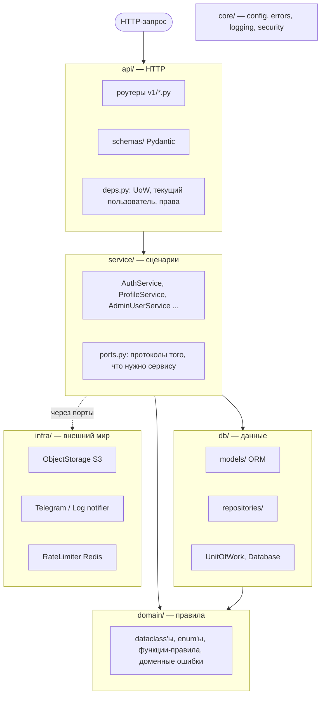
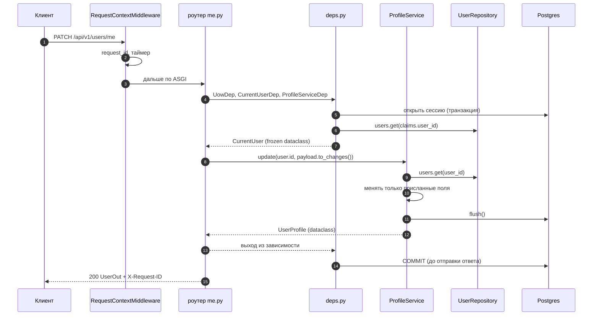
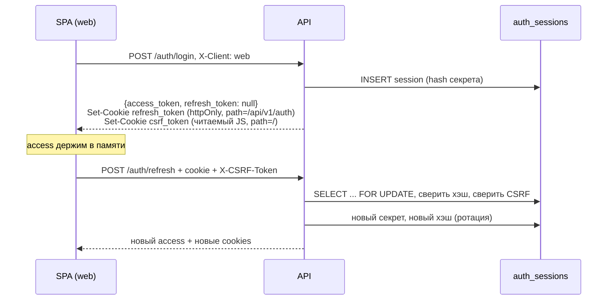
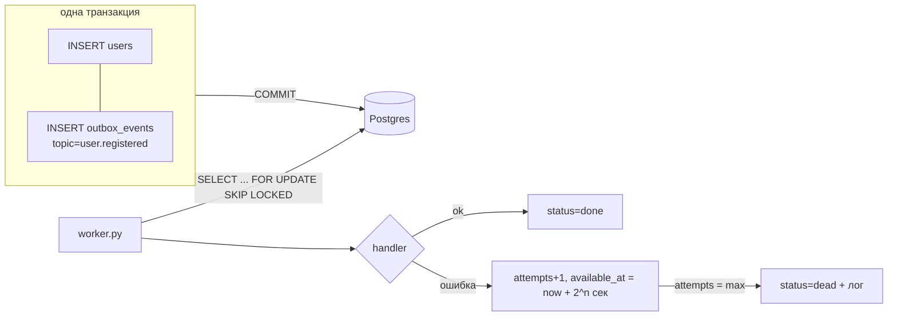
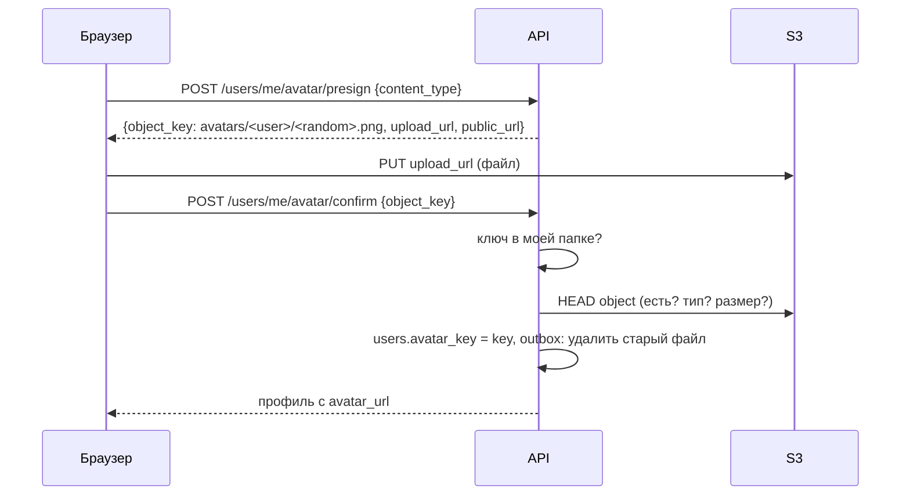

# Архитектура бэкенда: гайд по шаблону

Этот документ объясняет, как устроен бэкенд шаблона и почему он устроен именно так. Его можно читать
сверху вниз как учебник, а можно открывать нужный раздел, когда пишешь новую фичу. Все ссылки ведут
в реальный код репозитория.

Содержание:

1. [Коротко](#1-коротко)
2. [Карта репозитория](#2-карта-репозитория)
3. [Слои и правило зависимостей](#3-слои-и-правило-зависимостей)
4. [Путь одного запроса](#4-путь-одного-запроса)
5. [Три вида моделей](#5-три-вида-моделей)
6. [Транзакции и Unit of Work](#6-транзакции-и-unit-of-work)
7. [Ошибки](#7-ошибки)
8. [Аутентификация](#8-аутентификация)
9. [Авторизация: роли и права](#9-авторизация-роли-и-права)
10. [Побочные эффекты: outbox и воркер](#10-побочные-эффекты-outbox-и-воркер)
11. [Файлы: загрузка напрямую в S3](#11-файлы-загрузка-напрямую-в-s3)
12. [Конфигурация и секреты](#12-конфигурация-и-секреты)
13. [Наблюдаемость](#13-наблюдаемость)
14. [Тесты](#14-тесты)
15. [Миграции](#15-миграции)
16. [Рецепт: как добавить новую фичу](#16-рецепт-как-добавить-новую-фичу)
17. [Запуск и деплой](#17-запуск-и-деплой)
18. [Что поменялось по сравнению со старым шаблоном](#18-что-поменялось-по-сравнению-со-старым-шаблоном)
19. [Сознательные компромиссы](#19-сознательные-компромиссы)

---

## 1. Коротко

Монолит на FastAPI + SQLAlchemy 2 (async) + Postgres + Redis + S3-совместимое хранилище.
Из коробки есть регистрация и вход (web через httpOnly-cookie, mobile через токены в теле), профиль
с аватаром, админка (поиск пользователей, бан, роли, статистика), фоновый воркер, миграции и
тесты на настоящих Postgres, Redis и S3.

Пять правил, на которых держится всё остальное:

1. **Стрелки зависимостей идут только вниз:** `api → service → domain`. Домен не знает про FastAPI и
   SQLAlchemy, сервисы не знают про HTTP.
2. **Одна транзакция на запрос.** Коммитит только владелец транзакции (зависимость `UowDep`, воркер,
   CLI). Сервисы делают `flush()`.
3. **ORM-объекты не выходят за пределы `db/` и `service/`.** API получает доменные dataclass'ы и
   превращает их в Pydantic-схемы ответа.
4. **Побочные эффекты происходят после коммита** через outbox: письма, Telegram, удаление файлов.
5. **Ничего не создаётся при импорте.** Настройки, движок БД и клиенты появляются в `create_app()`
   и передаются явно, поэтому тест может собрать приложение с любыми настройками.

---

## 2. Карта репозитория

```text
backend/
  app/
    main.py                 create_app(): фабрика приложения, lifespan, middleware
    worker.py               отдельный процесс: доставка outbox-событий, чистка сессий
    cli.py                  python -m app.cli create-admin <email>
    core/                   общее для всех слоёв, без бизнес-логики
      config.py             Settings: все настройки, проверка прод-конфига
      errors.py             ErrorCode и иерархия DomainError
      logging.py            JSON/текстовые логи с request_id
      security/             пароли (argon2id), JWT-кодек, refresh-токены
    domain/                 чистые правила и типы: никаких FastAPI/SQLAlchemy
    db/                     ORM-модели, репозитории, UnitOfWork, Database
    infra/                  адаптеры к внешнему миру: S3, Telegram, rate limit
    service/                сценарии использования: оркестрируют домен, репозитории и infra
    api/                    HTTP: роутеры, схемы, зависимости, ошибки, middleware
  migrations/               Alembic
  tests/
    unit/                   без Docker, ~1 с
    integration/            реальные Postgres/Redis/S3 из docker-compose.test.yml
    factories.py            register(), login(), promote(), фейковый notifier
frontend/                   SPA (React), ходит в /api/v1
nginx/                      отдаёт SPA, проксирует /api и медиа
docker-compose.yml          весь стек локально
docker-compose.test.yml     одноразовые зависимости для тестов
Makefile                    единая точка входа: make help
```

---

## 3. Слои и правило зависимостей



Что разрешено импортировать:

| Слой | Может импортировать | Не может |
|---|---|---|
| `domain/` | стандартная библиотека, `core.errors` | FastAPI, SQLAlchemy, Pydantic, `db`, `service`, `api` |
| `db/` | SQLAlchemy, `domain`, `core` | FastAPI, `service`, `api` |
| `infra/` | внешние SDK (boto3, httpx, redis), `core` | `service`, `api` |
| `service/` | `domain`, `db`, `infra`, `core` | FastAPI, `api` |
| `api/` | всё выше, FastAPI, Pydantic | SQLAlchemy-запросы, ORM-модели |

Куда класть код, на примере «админ банит пользователя»:

| Вопрос | Где | Код |
|---|---|---|
| Как выглядит запрос и ответ? | `api/schemas` | [`UserOut`](../backend/app/api/schemas/users.py) |
| Кто вообще может вызвать? | `api/deps.py` | `require(Permission.USERS_BAN)` в [admin.py](../backend/app/api/v1/admin.py) |
| Какое бизнес-правило? | `domain` | [`ensure_can_ban`](../backend/app/domain/users.py): нельзя себя и других админов |
| Какие шаги и в каком порядке? | `service` | [`AdminUserService.ban`](../backend/app/service/admin.py): заблокировать строку, проверить правило, поставить `banned_at`, поднять `auth_version`, отозвать сессии |
| Как достать и сохранить? | `db/repositories` | [`UserRepository.get(for_update=True)`](../backend/app/db/repositories/users.py) |
| Когда коммит? | граница запроса | [`UowDep`](../backend/app/api/deps.py) |

---

## 4. Путь одного запроса

Возьмём `PATCH /api/v1/users/me {"bio": null}`.



Код на каждом шаге:

```python
# api/v1/me.py: роутер ничего не решает, только переводит HTTP в вызов сервиса и обратно
@router.patch(path="", summary="Update profile fields; omitted fields stay unchanged")
async def update_me(payload: ProfileUpdate, user: CurrentUserDep, svc: ProfileServiceDep) -> UserOut:
    return UserOut.from_domain(await svc.update(user.id, payload.to_changes()))
```

```python
# api/schemas/users.py: схема знает, какие поля клиент реально прислал
def to_changes(self) -> ProfileChanges:
    sent = self.model_fields_set
    return ProfileChanges(
        username=self.username if "username" in sent else UNSET,
        bio=self.bio if "bio" in sent else UNSET,
    )
```

```python
# service/profile.py: сценарий без HTTP; не коммитит
async def update(self, user_id: UUID, changes: ProfileChanges) -> UserProfile:
    user = await self._user(user_id)
    if changes.username is not UNSET:
        user.username = changes.username
    if changes.bio is not UNSET:
        user.bio = changes.bio
    await self._uow.flush()
    return to_profile(user, self._storage)
```

Почему `UNSET`, а не `exclude_none`: с `exclude_none` клиент не может очистить поле, потому что
`{"bio": null}` просто проигнорируется. `UNSET` отличает «не прислал» от «прислал null»
([domain/common.py](../backend/app/domain/common.py)).

---

## 5. Три вида моделей

| Вид | Где | Для чего | Пример |
|---|---|---|---|
| ORM-модель | `db/models/` | колонки, индексы, связи. Без логики | [`User`](../backend/app/db/models/users.py) |
| Доменная модель | `domain/` | то, чем оперирует логика: `@dataclass(frozen=True, slots=True)` | [`UserProfile`, `CurrentUser`](../backend/app/domain/users.py) |
| Схема API | `api/schemas/` | контракт с клиентом: валидация входа, форма ответа | [`UserOut`, `ProfileUpdate`](../backend/app/api/schemas/users.py) |

Переходы делаются явно, маленькими функциями:

```python
# service/mappers.py: ORM -> домен (тут же собирается URL аватара: это знание хранилища, а не таблицы)
def to_profile(user: User, urls: PublicUrls) -> UserProfile:
    return UserProfile(
        id=user.id,
        ...
        avatar_url=urls.public_url(user.avatar_key) if user.avatar_key else None,
        is_banned=user.banned_at is not None,
        ...
    )

# api/schemas/users.py: домен -> JSON
class UserOut(ResponseModel):
    banned: bool = Field(..., validation_alias="is_banned")

    @classmethod
    def from_domain(cls, profile: UserProfile) -> Self:
        return cls.model_validate(profile)
```

Почему не отдавать ORM напрямую в Pydantic (`from_attributes=True` на ORM-объекте):

- **async-ловушка.** Pydantic полезет в незагруженную связь, и получишь `MissingGreenlet`. Обычно
  это лечат `lazy="selectin"`, и тогда каждый запрос тянет связи, даже когда они не нужны;
- **контракт приклеен к таблице.** Переименовал колонку, и сломал фронт;
- **утечки.** Забыл `response_model`, и наружу ушёл `password_hash`;
- **логика переезжает в ORM** ради вычисляемых полей (раньше `avatar_url` вызывал `get_settings()`
  прямо из модели таблицы).

`from_attributes=True` сам по себе не плох: в `ResponseModel` он включён, но на вход ему идут
доменные dataclass'ы.

Запросы и ответы разделены: [`RequestModel`](../backend/app/api/schemas/base.py) запрещает
лишние поля (`extra="forbid"`), поэтому опечатка клиента или попытка прислать `{"role": "admin"}`
в PATCH даёт 422, а не молча игнорируется.

---

## 6. Транзакции и Unit of Work

Это самое важное место шаблона.

```python
# db/database.py
@asynccontextmanager
async def unit_of_work(self) -> AsyncIterator[UnitOfWork]:
    async with self._sessions() as session:
        try:
            yield UnitOfWork(session)
        except DomainError as exc:
            if exc.keep_changes:
                await session.commit()
            else:
                await session.rollback()
            raise
        except BaseException:
            await session.rollback()
            raise
        await session.commit()
```

```python
# api/deps.py
async def _unit_of_work(db: DatabaseDep) -> AsyncIterator[UnitOfWork]:
    async with db.unit_of_work() as uow:
        yield uow

# scope="function": the commit runs before the response is sent
UowDep = Annotated[UnitOfWork, Depends(_unit_of_work, scope="function")]
```

Правила:

1. **Владелец транзакции коммитит, остальные нет.** В HTTP владелец это `UowDep`, в воркере и CLI
   это `async with db.unit_of_work()`. Сервис зовёт только `await self._uow.flush()`: так он получает
   id и ловит нарушения constraint'ов, не завершая транзакцию.
2. **`scope="function"` обязателен.** По умолчанию (`scope="request"`) код после `yield` выполняется
   *после отправки ответа*. Тогда упавший коммит превращается в «клиент получил 200, а данных нет».
   Со `scope="function"` коммит идёт до ответа, и его падение даёт честный 500.
3. **Один UoW на запрос.** FastAPI кэширует зависимости в рамках запроса, поэтому `current_user`
   и сервис работают в одной сессии.
4. **Ошибка откатывает всё**, кроме ошибок с `keep_changes = True`. Такая сейчас одна:
   `RefreshTokenReusedError`. Мы отзываем сессию *и* отвечаем 401, и отзыв должен сохраниться.
5. **Конкурентные изменения через блокировку строки:** `users.get(id, for_update=True)` и
   `sessions.get_for_update()`. Тест `test_parallel_refreshes_with_one_token_cannot_both_win`
   доказывает, что два параллельных refresh одним токеном не проходят оба.

Почему сервисы не коммитят сами: сервис нельзя было бы скомбинировать с другим. Если сценарий
вызывает два метода и второй падает, первый уже закоммичен, и данные остаются наполовину записанными.

---

## 7. Ошибки

Все ожидаемые ошибки наследуют [`DomainError`](../backend/app/core/errors.py) и несут три вещи:
HTTP-статус, машинный `error_code` из закрытого списка `ErrorCode` и человекочитаемый `detail`.

```python
class EmailTakenError(ConflictError):          # domain/users.py
    error_code = ErrorCode.EMAIL_TAKEN
    default_detail = "This email is already registered"
```

Любая ошибка API, включая 404 от роутинга, 422 от валидации и 500, имеет один формат
(RFC 7807, `application/problem+json`), его собирает [api/problems.py](../backend/app/api/problems.py):

```json
{
  "type": "about:blank",
  "title": "Conflict",
  "status": 409,
  "detail": "This email is already registered",
  "error_code": "EMAIL_TAKEN",
  "instance": "/api/v1/auth/register",
  "timestamp": "2026-10-27T10:00:00+00:00",
  "request_id": "6e9a99671bc44858a9f05a95b78554ff"
}
```

Правила:

- клиент ветвится по `error_code`, а не по тексту `detail`;
- `except Exception` допустим только на границах (обработчик 500, цикл воркера, readiness-проба);
- в 500 наружу уходит `"Internal server error"`, подробности остаются в логе с тем же `request_id`
  (в `DEBUG=true` в ответе будет тип и текст исключения).

> Компромисс: доменные ошибки знают свой HTTP-статус. Пурист вынес бы сопоставление «ошибка → статус»
> в `api/`. Для монолита это лишняя церемония, а `status_code` у ошибки читается сразу.

---

## 8. Аутентификация

### Токены

| | Access | Refresh |
|---|---|---|
| Формат | JWT RS256 | непрозрачная строка `<session_id>.<secret>` |
| Живёт | 15 минут (`ACCESS_TTL`) | 30 дней, продлевается при ротации (`REFRESH_TTL`) |
| Где хранится на сервере | нигде | таблица `auth_sessions`, только SHA-256 от `secret` |
| Что внутри | `sub` (user id), `sid` (session id), `av` (auth_version), `typ`, `iat`, `exp` | ничего, это ключ в БД |

Код: [core/security/tokens.py](../backend/app/core/security/tokens.py),
[service/auth.py](../backend/app/service/auth.py).

### Web и mobile



- **web**: refresh-токен лежит в httpOnly-cookie, и JS его не видит (защита от XSS). Cookie шлётся
  только на `/api/v1/auth/*`. Для защиты от CSRF SPA повторяет значение cookie `csrf_token` в заголовке
  `X-CSRF-Token` (double-submit cookie). CSRF-токен это HMAC от refresh-токена: подделать его без
  ключа нельзя;
- **mobile**: `X-Client: mobile`, оба токена приходят в теле, refresh отправляется как
  `Authorization: Bearer`.

### Ротация и обнаружение кражи

На каждом refresh секрет меняется. Если пришёл *старый* секрет живой сессии, значит, токен
скопировали. Мы не знаем, кто из двоих вор, поэтому убиваем сессию целиком (`REFRESH_TOKEN_REUSED`),
и обоим придётся войти заново.

### Мгновенный отзыв доступа: `auth_version`

Access-токены нигде не хранятся, поэтому отозвать один конкретный нельзя. Вместо этого:

- в токене лежит `av`, а в строке пользователя `auth_version`;
- [`resolve_current_user`](../backend/app/service/auth.py) на каждом запросе делает один запрос по
  первичному ключу и сверяет версию;
- бан и «выйти везде» (`POST /auth/logout-all`) поднимают `auth_version`, и все выданные access-токены
  умирают на следующем же запросе.

Обычный `logout` отзывает только refresh-сессию. Access-токен доживает свои ≤15 минут: это
стандартный компромисс.

### Пароли

argon2id ([core/security/passwords.py](../backend/app/core/security/passwords.py)), хэширование в
отдельном потоке, чтобы не блокировать event loop. При неизвестном email всё равно выполняется
проверка против фиктивного хэша, поэтому время ответа не выдаёт, какие email зарегистрированы.
Если параметры argon2 поменяются, хэш тихо обновится при следующем входе (`needs_rehash`).

### Rate limit

`/auth/register`, `/auth/login` и `/auth/refresh` ограничены по IP
(`AUTH_RATE_LIMIT_PER_MINUTE`, окно 60 с) через [infra/rate_limit.py](../backend/app/infra/rate_limit.py).
Если Redis лежит, лимитер пропускает запросы (fail open): падение Redis не должно запирать всех
пользователей снаружи.

---

## 9. Авторизация: роли и права

Роли это код, а не таблицы ([domain/users.py](../backend/app/domain/users.py)):

```python
class Permission(StrEnum):
    USERS_READ = "users:read"
    USERS_BAN = "users:ban"
    USERS_MANAGE_ROLES = "users:manage_roles"
    STATS_READ = "stats:read"

ROLE_PERMISSIONS: Mapping[Role, frozenset[Permission]] = {
    Role.MEMBER: frozenset(),
    Role.ADMIN: frozenset(Permission),
}
```

У пользователя одна колонка `role` (Postgres enum). Проверка прав не требует ни БД, ни Redis:

```python
UsersBanner = Annotated[CurrentUser, Depends(require(Permission.USERS_BAN))]

@router.post(path="/users/{user_id}/ban")
async def ban_user(user_id: UUID, admin: UsersBanner, uow: UowDep, storage: StorageDep) -> UserOut: ...
```

Эндпоинты проверяют *права*, а не названия ролей. Новая роль `moderator` добавляется одной строкой в
`ROLE_PERMISSIONS` и значением в `Role` (плюс миграция enum'а), роутеры трогать не нужно.

Правила, которые зависят от данных («нельзя банить админа», «нельзя менять свою роль»), живут в
домене и вызываются из сервиса: `require()` знает только «кто ты», а не «что ты трогаешь».

Первый админ создаётся из CLI: `make admin email=you@example.com` (пароль спросит или возьмёт из
`ADMIN_PASSWORD`).

---

## 10. Побочные эффекты: outbox и воркер

Проблема: если отправить Telegram-уведомление или удалить файл *внутри* запроса, то при откате
транзакции эффект уже случился. А если отправлять после коммита в том же процессе, то при падении
процесса между коммитом и отправкой эффект потеряется.

Решение: в **той же транзакции**, что и изменение, записать событие в таблицу `outbox_events`.
Отдельный процесс-воркер забирает события и выполняет их, с ретраями.



```python
# service/auth.py: регистрация кладёт событие, ничего не отправляя
self._uow.outbox.add(Topic.USER_REGISTERED, {"user_id": str(user.id), "email": email})

# service/outbox.py: обработчики, их вызывает воркер
async def user_registered(payload: dict[str, Any]) -> None:
    await notifier.send(f"New user registered: {payload['email']}")
```

Свойства:

- **at-least-once**: событие может выполниться дважды (упали после отправки, но до отметки `done`),
  поэтому обработчики идемпотентны. Удаление в S3 идемпотентно само по себе;
- несколько копий воркера можно запускать параллельно: `SKIP LOCKED` раздаёт им разные события;
- откатился запрос, откатилось и событие (тест `test_failed_request_leaves_no_event`).

Новый побочный эффект добавляется так: значение в [`Topic`](../backend/app/domain/events.py),
`uow.outbox.add(...)` в сервисе, обработчик в [`build_handlers`](../backend/app/service/outbox.py).

---

## 11. Файлы: загрузка напрямую в S3

Файлы не идут через API: API выдаёт presigned URL, браузер грузит файл прямо в хранилище, потом
API проверяет загруженное.



Проверки лежат в домене ([domain/avatars.py](../backend/app/domain/avatars.py)): ключ должен лежать
под `avatars/<твой id>/`, тип из белого списка, размер не больше `MAX_AVATAR_SIZE_MB`. Старый файл
удаляет воркер после коммита.

Локально S3 изображает **RustFS** (S3-совместимый, Apache-2.0; MinIO больше не публикует образы).
В проде это любой S3: AWS, Cloudflare R2, Yandex Object Storage. Меняются только `STORAGE_*`.

---

## 12. Конфигурация и секреты

Все настройки описаны в одном классе [`Settings`](../backend/app/core/config.py). Значения берутся
из переменных окружения и `backend/.env`, имена переменных не чувствительны к регистру.

```python
def create_app(settings: Settings | None = None) -> FastAPI:
    settings = settings or get_settings()   # get_settings() зовут только точки входа
    ...
    app.state.settings = settings
```

- нигде нет `Settings()` на уровне модуля. Внутри запроса настройки достаются через `SettingsDep`,
  в сервис нужные значения приходят аргументами конструктора;
- в `APP_STAGE=prod` приложение **не стартует**, если остались dev-значения (`CSRF_HMAC_KEY=change-me`,
  ключ хранилища по умолчанию, `COOKIE_SECURE=false`, `DEBUG=true`). Тест: `test_production_refuses_development_secrets`;
- секреты имеют тип `SecretStr`, поэтому не печатаются в логах и `repr`;
- JWT-ключи задаются либо путём к файлу (`JWT_*_PATH`, локально их создаёт `make keys`), либо
  значением (`JWT_PRIVATE_KEY`) из секрет-менеджера в проде;
- Alembic берёт только `DATABASE_URL` ([`MigrationSettings`](../backend/app/core/config.py)), так что
  JWT-ключи для миграций не нужны.

---

## 13. Наблюдаемость

- **request id.** [`RequestContextMiddleware`](../backend/app/api/middleware.py) берёт `X-Request-ID`
  от клиента (если он безопасный) или генерирует свой, кладёт его в `contextvars`, в ответ
  (`X-Request-ID`, `X-Process-Time-Ms`) и в тело ошибок. Каждая строка лога содержит этот id;
- **логи.** `LOG_JSON=true` в проде даёт по одному JSON на строку для Loki/ELK/Datadog. В dev
  включён читаемый текст. На каждый запрос пишется одна access-строка: метод, путь, статус, время;
- **health.** `GET /api/health` (liveness) отвечает, что процесс жив, и никогда не трогает
  зависимости. `GET /api/ready` (readiness) проверяет Postgres, Redis и S3 параллельно с таймаутом
  2 с и отвечает 503, если хоть одна зависимость лежит. Оркестратор перезапускает по первому и не шлёт
  трафик по второму.

---

## 14. Тесты

### Запуск

```bash
make test-unit   # только unit: без Docker, ~1 с
make test        # всё: поднимет Postgres/Redis/S3 из docker-compose.test.yml (если ещё не подняты), ~5 с
make test-down   # убрать тестовые контейнеры
make check       # lint + mypy + все тесты: ровно то, что гоняет CI
```

Тестовые контейнеры работают на других портах (5439, 6380, 9002), так что не мешают dev-стеку.
Postgres в них живёт в `tmpfs`, поэтому быстрый и одноразовый.

### Пирамида

```text
            ┌──────────────────────────┐
            │  integration (≈40)       │  HTTP → весь стек → настоящие Postgres/Redis/S3
            ├──────────────────────────┤
            │  unit (≈40)              │  домен, токены, пароли, курсоры, сервис на фейках
            └──────────────────────────┘
```

- **unit** ([tests/unit](../backend/tests/unit)): чистые функции и сервисы с фейками. Домен не
  зависит от БД, поэтому тестируется без неё;
- **integration** ([tests/integration](../backend/tests/integration)): настоящее приложение через
  `httpx.ASGITransport` (без сети, но с lifespan и всеми middleware) против настоящих зависимостей.
  Схему создают **настоящие миграции**, так что тесты заодно проверяют, что миграции работают.
  Отдельный тест сверяет модели с миграциями (`test_models_match_migrations`): если поменял модель и
  забыл миграцию, тест упадёт.

Всё в `tests/integration/` автоматически помечается маркером `integration`
(`pytest -m "not integration"` запускает только быстрые тесты).

### Готовые фикстуры

| Фикстура | Что даёт |
|---|---|
| `client` | `httpx.AsyncClient` к приложению; база и Redis очищены перед тестом |
| `user` | зарегистрированный участник: `user.headers`, `user.refresh_token`, `user.email` |
| `admin` | то же, но с ролью admin |
| `db` | `Database` приложения: проверить строки, запустить код воркера |
| `storage` | `ObjectStorage` приложения |
| `run_outbox` | `await run_outbox()` = одна итерация воркера |
| `notifier` | `RecordingNotifier`: что «отправилось в Telegram»; `fail_with` для ретраев |
| `app_factory` | приложение с другими настройками: `async with app_factory(rate_limit_enabled=True) as (app, client)` |
| `make_settings` | `Settings` для тестов с оверрайдами |

### Как выглядит тест

Интеграционный:

```python
async def test_ban_kills_sessions_and_blocks_login(admin: Account, user: Account, client: AsyncClient) -> None:
    banned = await client.post(f"/api/v1/admin/users/{user.id}/ban", headers=admin.headers)
    assert banned.json()["banned"] is True

    me = await client.get("/api/v1/users/me", headers=user.headers)
    assert me.status_code == 401
```

Побочный эффект:

```python
async def test_registration_notifies_after_commit(client, db, notifier, run_outbox) -> None:
    await register(client, email="new@example.com")
    assert notifier.messages == []          # из запроса ничего не отправлено
    assert await run_outbox() == 1
    assert notifier.messages == ["New user registered: new@example.com"]
```

Сервис без БД ([test_profile_service.py](../backend/tests/unit/test_profile_service.py)): сервис
зависит от UoW и маленьких протоколов ([service/ports.py](../backend/app/service/ports.py)), поэтому
хватает пары фейков на десять строк:

```python
class FakeStorage:
    def __init__(self) -> None:
        self.objects: dict[str, ObjectInfo] = {}

    def public_url(self, key: str) -> str:
        return f"https://cdn.test/{key}"
    ...

service = ProfileService(FakeUow(user), FakeStorage(), presign_expires_sec=60, max_avatar_bytes=1024)
```

Что тестировать каким уровнем:

- правило («нельзя банить админа»): unit на доменную функцию;
- сценарий с ветками (замена аватара, PATCH): unit на сервис с фейками;
- то, что зависит от SQL, транзакций, cookies, заголовков, формата ошибок: integration;
- каждому эндпоинту нужен хотя бы один интеграционный тест на успех и один на главную ошибку.

### Строгость

В pytest включено `error::DeprecationWarning:app.*`: устаревший API в нашем коде роняет тесты.
Именно так нашлось, что в SQLAlchemy 2.1 `Result.tuples()` устарел.

---

## 15. Миграции

```bash
make migration m="add posts"   # autogenerate по моделям (нужна БД из backend/.env, например `make up`)
# открыть файл в migrations/versions/ и прочитать глазами
make migrate                   # применить
```

Правила:

- **autogenerate это черновик.** Он не видит расширений (`CREATE EXTENSION`), не удаляет
  Postgres-enum'ы в `downgrade`, может не так понять переименование. Пример ручной правки есть в
  начальной миграции;
- у каждой миграции рабочий `downgrade()`. Тест `test_downgrade_and_upgrade_again` гоняет base → head;
- имена constraint'ов и индексов детерминированы через `naming_convention` в
  [db/base.py](../backend/app/db/base.py), поэтому `downgrade` может удалять их по имени;
- в контейнерах миграции идут **отдельным шагом**: compose-сервис `migrate`, `release_command` на
  Fly. Если запускать их на старте каждой реплики API, реплики гоняются друг с другом.

---

## 16. Рецепт: как добавить новую фичу

Пусть это «посты пользователя»: создать, получить список своих, удалить.

**1. Домен**: `app/domain/posts.py`

```python
@dataclass(frozen=True, slots=True)
class PostInfo:
    id: UUID
    author_id: UUID
    title: str
    body: str
    created_at: datetime


class PostNotFoundError(NotFoundError):
    error_code = ErrorCode.POST_NOT_FOUND   # добавить в ErrorCode
    default_detail = "Post not found"


def ensure_can_delete(actor: CurrentUser, author_id: UUID) -> None:
    # POSTS_MODERATE: новое право в Permission; у admin оно появится само (frozenset(Permission))
    if actor.id != author_id and not actor.can(Permission.POSTS_MODERATE):
        raise ForbiddenError()
```

**2. ORM-модель и миграция**: `app/db/models/posts.py`, импорт в `db/models/__init__.py`, затем
`make migration m="add posts"`.

```python
class Post(UuidPkMixin, TimestampMixin, Base):
    __tablename__ = "posts"

    author_id: Mapped[UUID] = mapped_column(ForeignKey("users.id", ondelete="CASCADE"))
    title: Mapped[str] = mapped_column(String(200))
    body: Mapped[str] = mapped_column(Text)

    __table_args__ = (Index("ix_posts_author_created", "author_id", "created_at"),)
```

**3. Репозиторий**: `app/db/repositories/posts.py`, подключить в
[`UnitOfWork`](../backend/app/db/uow.py) как `self.posts`.

```python
class PostRepository:
    def __init__(self, session: AsyncSession) -> None:
        self._session = session

    def add(self, post: Post) -> None:
        self._session.add(post)

    async def get(self, post_id: UUID) -> Post | None:
        return await self._session.get(Post, post_id)

    async def by_author(self, author_id: UUID, *, limit: int) -> Sequence[Post]:
        stmt = (
            select(Post)
            .where(Post.author_id == author_id)
            .order_by(Post.created_at.desc())
            .limit(limit)
        )
        return (await self._session.scalars(stmt)).all()
```

**4. Сервис**: `app/service/posts.py`, возвращает доменные объекты и не коммитит.

```python
class PostService:
    def __init__(self, uow: UnitOfWork, actor: CurrentUser) -> None:
        self._uow = uow
        self._actor = actor

    async def create(self, title: str, body: str) -> PostInfo:
        post = Post(author_id=self._actor.id, title=title, body=body)
        self._uow.posts.add(post)
        await self._uow.flush()
        return _to_info(post)   # маппер ORM -> PostInfo, как to_profile в service/mappers.py

    async def delete(self, post_id: UUID) -> None:
        post = await self._uow.posts.get(post_id)
        if post is None:
            raise PostNotFoundError()
        ensure_can_delete(self._actor, post.author_id)
        await self._uow.session.delete(post)
```

**5. Схемы и роутер**: `app/api/schemas/posts.py`, `app/api/v1/posts.py`, подключить в
[api/router.py](../backend/app/api/router.py).

```python
class PostCreate(RequestModel):
    title: str = Field(..., min_length=1, max_length=200)
    body: str = Field(..., min_length=1, max_length=10_000)


class PostOut(ResponseModel):
    id: UUID
    title: str
    body: str
    created_at: datetime

    @classmethod
    def from_domain(cls, post: PostInfo) -> Self:
        return cls.model_validate(post)


@router.post(path="/posts", status_code=201, summary="Create a post")
async def create_post(payload: PostCreate, user: CurrentUserDep, uow: UowDep) -> PostOut:
    return PostOut.from_domain(await PostService(uow, user).create(payload.title, payload.body))
```

**6. Тесты**: unit на `ensure_can_delete`, integration «создал → вижу в списке → чужой удалить не
может → свой удалил».

**7. Фронт**: `make openapi` обновит `frontend/openapi.json`.

Чеклист перед коммитом: `make check` зелёный, миграция прочитана глазами и у неё есть `downgrade`.

---

## 17. Запуск и деплой

### Локально

```bash
make install          # uv sync + backend/.env + JWT-ключи
make up               # весь стек в Docker: http://localhost (SPA + API), API напрямую на :8080
make admin email=me@example.com
make logs
```

Разработка бэкенда с автоперезагрузкой: `make up` поднимет зависимости, затем
`docker compose stop backend worker` и `make run` + `make worker` локально.
Документация API: <http://localhost:8080/api/docs> (в проде выключена).

### Состав стека ([docker-compose.yml](../docker-compose.yml))

| Сервис | Что делает |
|---|---|
| `migrate` | `alembic upgrade head` один раз, потом завершается |
| `backend` | API (uvicorn), стартует только после успешной миграции |
| `worker` | outbox и чистка сессий; тот же образ, другая команда |
| `nginx` | SPA, проксирование `/api` и `/media-public` |
| `db`, `redis`, `s3` | Postgres 17, Redis 8, RustFS |

### Образ ([backend/Dockerfile](../backend/Dockerfile))

Двухстадийная сборка: uv ставит зависимости строго по `uv.lock`, в финальном образе нет ни uv, ни
тестов, процесс работает не под root. API запускается фабрикой:
`uvicorn app.main:create_app --factory`.

### Прод (Fly.io как пример, [fly.toml](../backend/fly.toml))

- секреты задаются через `fly secrets set`: `DATABASE_URL`, `REDIS_URL`, `JWT_PRIVATE_KEY`,
  `JWT_PUBLIC_KEY`, `CSRF_HMAC_KEY`, `STORAGE_*`;
- `release_command = alembic upgrade head` выполняется один раз на релиз;
- процессы `app` и `worker` запускаются из одного образа;
- деплой запускается вручную (GitHub Actions → `fly-deploy-backend` → Run workflow): шаблон не
  должен деплоить себя на каждый push.

### CI ([backend-ci.yml](../.github/workflows/backend-ci.yml))

ruff (lint + format) → mypy `--strict` → все тесты на реальных сервисах → сборка образа.
`allow_failure` нигде нет.

---

## 18. Что поменялось по сравнению со старым шаблоном

Старая версия сохранена в ветке `legacy`.

| Было | Стало | Почему |
|---|---|---|
| `get_uow` с `scope` по умолчанию: коммит после отправки ответа | `Depends(..., scope="function")`, коммит до ответа | упавший коммит давал 200 без данных |
| `await self.uow.commit()` внутри сервисов, флаг `_committed`, который ничего не делал | сервисы делают `flush()`, коммитит владелец UoW | сервисы можно комбинировать, нет «половины записи» |
| Telegram отправлялся внутри транзакции регистрации | outbox + воркер с ретраями | нет эффекта при откате, нет потери при падении |
| ORM `User` возвращался из `auth_user` и роутеров, `from_attributes` на ORM | `CurrentUser`/`UserProfile` (dataclass) → `UserOut.from_domain` | контракт отделён от таблицы, нет ленивых загрузок |
| `avatar_url` в ORM-модели вызывал `get_settings()` | URL собирает сервис через хранилище | таблица не знает про S3 |
| `auth_version` проверялся только в `require()` | проверяется на каждом запросе | после бана/смены сессий старый токен жил на обычных эндпоинтах |
| refresh пропускал токен со старым `auth_version` (только писал в лог) | сессии в БД; бан и logout-all отзывают их | забаненный мог обновлять токены |
| access и refresh с одинаковым `jti`, refresh это JWT с блоклистом в Redis | refresh непрозрачный, ротация с детектом повторного использования | кража refresh-токена обнаруживается |
| при неизвестном email ответ без хэширования | сравнение с фиктивным хэшем | по времени нельзя перебирать email |
| роли в таблицах M2M + `lazy="selectin"` + кэш ролей в Redis | одна колонка `role`, права в коде | ноль лишних запросов, бесполезный кэш убран |
| `config = Settings()` на импорте в нескольких модулях | `Settings` создаётся в `create_app` и передаётся | тесты подменяют настройки, импорт без `.env` не падает |
| сервисный слой импортировал `fastapi.Depends` | DI только в `api/deps.py` | сервисы не зависят от веб-фреймворка |
| `domain/` содержал Pydantic-схемы API | `domain/` = правила и dataclass'ы, схемы в `api/schemas` | название соответствует содержимому |
| PATCH через `exclude_none` и `setattr` в цикле | `UNSET` + явное присваивание полей | можно очистить поле; лишние поля → 422 |
| курсор `"<iso>_<uuid>"`, `next_cursor` выдавался и на последней странице | непрозрачный base64, запрос `limit + 1` | честный признак «есть ещё» |
| таблица `languages` без миграции, `updated_at` nullable в БД и NOT NULL в модели | одна чистая миграция + тест на расхождение моделей и миграций | эндпоинт падал бы 500 |
| миграции запускались в `entry.sh` каждой реплики | отдельный шаг `migrate` / `release_command` | реплики не гоняются |
| APScheduler в каждом инстансе API | отдельный процесс `worker` | фоновая работа не дублируется и не мешает API |
| `/docs` открыт всегда, CORS настроен, но не подключён | docs по флагу (в prod выключены), CORS подключается, если задан | каждая настройка используется |
| ruff только `E9,F63,F7`, без mypy | полный ruff + `mypy --strict`, CI без поблажек | ошибки ловятся до ревью |
| MinIO + `minio/mc` | RustFS, бакет и политику создаёт приложение | образы MinIO больше не публикуются |
| poetry, `PYTHONPATH=src`, импорты `from core...` | uv, пакет `app`, абсолютные импорты `from app.core...` | быстрый воспроизводимый lock, нет конфликтов имён |
| закомментированный код, пустые пакеты `queue/`, `workers/`, `webhooks/` | удалено | мёртвый код живёт в git, а не в файлах |

---

## 19. Сознательные компромиссы

- **Доменные ошибки знают HTTP-статус.** Это проще, чем отдельная таблица сопоставлений в `api/`.
- **Сервисы работают с ORM-объектами напрямую**, а не через доменные сущности с ручным маппингом в
  обе стороны. Для монолита на SQLAlchemy это норма: UoW отслеживает изменения сам. Наружу ORM при
  этом не выходит.
- **`logout` не убивает текущий access-токен**: он доживает ≤15 минут. Мгновенный отзыв есть через
  `logout-all` и бан (`auth_version`). Проверять сессию на каждом запросе значило бы платить лишним
  запросом за редкий случай.
- **Outbox опрашивается раз в секунду**, а не через `LISTEN/NOTIFY` или брокер. Для монолита этого
  хватает, а заменить можно, не трогая сервисы.
- **Rate limit с фиксированным окном** (не sliding window): чуть менее точен на границе окна, зато
  это две команды Redis.
- **Одна роль на пользователя.** Если понадобятся роли внутри организаций/команд, это отдельная
  таблица членства со своей ролью, а глобальная `role` остаётся.
