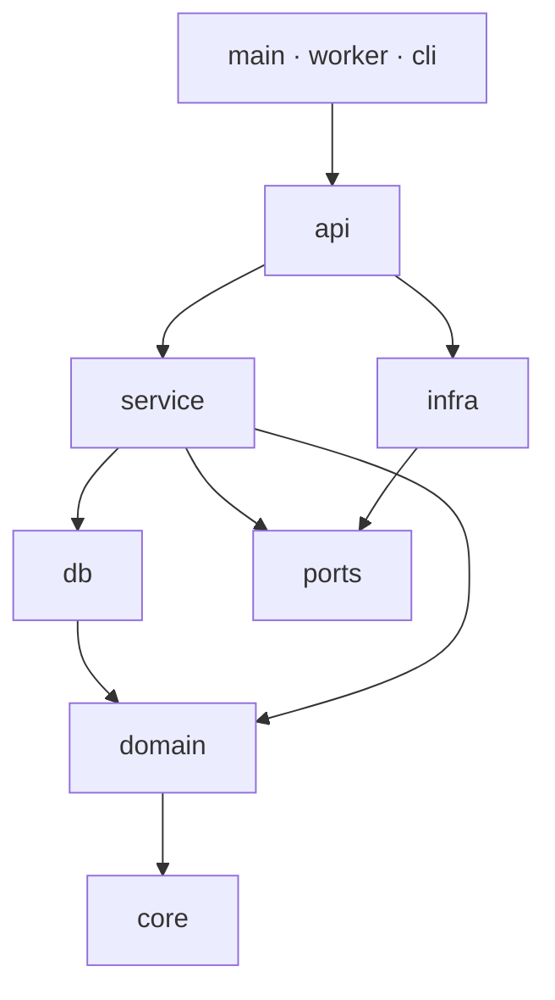
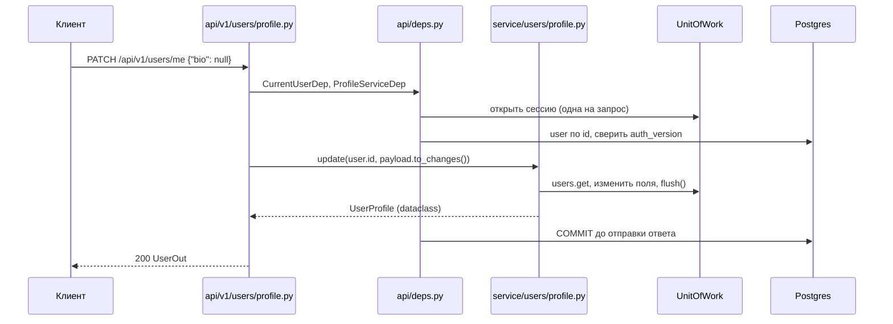
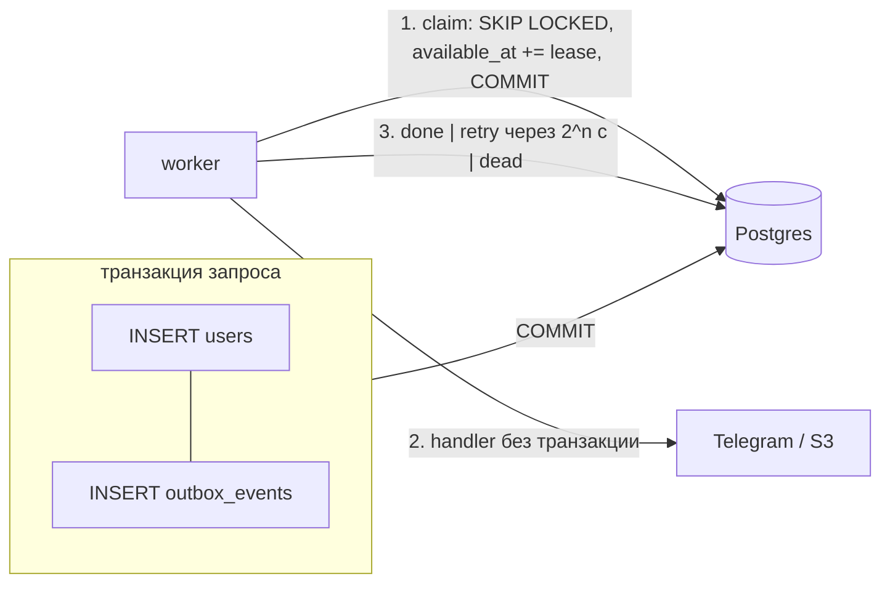

# Архитектура бэкенда

FastAPI-монолит со слоями: в каждом слое папки по зонам ответственности. Так устроены книга
[Architecture Patterns with Python](https://www.cosmicpython.com/book/appendix_project_structure.html)
(Cosmic Python) и [официальный шаблон FastAPI](https://github.com/fastapi/full-stack-fastapi-template).
Почему не модули по фичам и когда на них переходить: [D-001](../DECISIONS.md#d-001).

Соседние документы: [аутентификация и права](auth.md), [тесты](testing.md),
[рецепт новой фичи](new-feature.md).

## Карта

```text
backend/app/
  main.py, worker.py, cli.py   точки входа: собирают приложение, воркер и CLI из частей ниже
  api/                         HTTP
    deps.py                    общие зависимости: settings, UoW, current_user, require(), rate_limit
    problems.py, middleware.py формат ошибок RFC 7807, request id и access-лог
    schemas.py, router.py      базовые Pydantic-модели и сборка /api
    v1/<группа>/               auth, users, admin: файлы эндпоинтов, schemas.py, deps.py,
                               __init__.py собирает роутер группы и задаёт её URL
  service/<зона>/              сценарии: auth, users, moderation, stats, outbox
  domain/<зона>/               типы и правила без фреймворков: models.py, errors.py, rules.py
  ports/                       абстракции внешнего мира (Protocol): хранилище, уведомления
  infra/                       адаптеры, реализующие порты: S3, Telegram/лог, Redis rate limit
  db/                          base.py, database.py, uow.py, models/ (ORM), repositories/
  core/                        config, errors (DomainError, ErrorCode), logging, security
backend/migrations/            Alembic
backend/tests/                 unit/{core,domain,service}, integration/{api,...}
```

## Слои и правило зависимостей



Стрелка показывает, кто кого импортирует. Импорт вверх или вбок запрещён. Нарушение роняет
`make lint` и CI: правила записаны контрактами
[import-linter](https://import-linter.readthedocs.io/) в `backend/pyproject.toml`.

| Слой | Знает | Не знает |
| --- | --- | --- |
| `api` | FastAPI, схемы, сервисы, `require()` | SQL, ORM-модели, репозитории |
| `service` | UoW, репозитории, домен, порты | FastAPI, SQLAlchemy, httpx, boto3, redis |
| `infra` | SDK внешних систем, порты | сервисы, базу |
| `db` | SQLAlchemy, домен | HTTP, сервисы |
| `domain` | `core.errors` | фреймворки, базу, настройки, сеть |
| `ports` | ничего, это чистые Protocol | всё остальное |

### Контракты import-linter

| Контракт | Если упал |
| --- | --- |
| Layers (exhaustive) | импорт идёт вверх по слоям, либо появился пакет вне списка слоёв. Перенеси код в нужный слой или впиши новый пакет в `layers` |
| Domain is plain Python | домен тянет фреймворк, настройки или SDK. Передай значение аргументом, правило оставь чистым |
| Services use repositories and ports | сервис импортирует SQLAlchemy или SDK. Запрос перенеси в репозиторий, вызов внешней системы в адаптер за портом |
| Infra adapters do not touch the database | адаптер ходит в БД. Это работа репозитория |
| Endpoints never touch ORM models | роутер собирает SQL или трогает ORM. Перенеси в сервис |
| ORM models and repositories are protected | CLI или воркер пишут строки в обход сервиса. Вызови сервис |
| External SDKs are wired only in infra | клиент SDK создаётся не в адаптере и не в точке сборки |
| Zones never import each other in a cycle | две зоны одного слоя импортируют друг друга. Общее вынеси ниже или в третью зону |

Проверить нарушение руками: `cd backend && uv run lint-imports`.

## Импорты

- Только абсолютные, от `app.`. Ruff запрещает относительные (`ban-relative-imports = "all"`).
- Зона (`domain/users`, `service/auth`) открывает наружу свои публичные имена через
  `__init__.py` и `__all__`. Снаружи импортируем пакет: `from app.domain.users import Role`.
- Внутри зоны импортируем соседний файл напрямую: `from app.domain.users.models import Role`.
  Через собственный `__init__` нельзя, получится цикл.
- Исключение: `api/v1/<группа>/__init__.py` не реэкспортирует имена, а собирает `router`
  группы из файлов эндпоинтов и задаёт префиксы URL.

Публичный `__init__` позволяет разбить файл зоны на несколько, не трогая импорты в остальном коде.

## Как растёт зона

Начинай с одного файла на слой. Когда файл вырос примерно за 300 строк или в нём два независимых
сценария, раздели его внутри той же зоны: `service/users/profile.py` и `service/users/avatars.py`,
`__init__.py` реэкспортирует оба. Новая зона появляется, когда у кода свои данные и свои правила.
Называй зоны по смыслу (`moderation`, `billing`), а не по экрану или роли (`admin`).

Когда зон станет 8–10 или над бэкендом начнут работать несколько команд, раскладка по слоям
начинает мешать: одна фича размазана по пяти папкам. Тогда переходят на модули по фичам
(`app/<feature>/{api,service,domain,db}`) с тем же набором контрактов. Зоны во всех слоях уже
названы одинаково, поэтому переезд механический: [D-001](../DECISIONS.md#d-001).

## Путь одного запроса



Роутер переводит HTTP в вызов сервиса и обратно. Сервис ничего не знает про HTTP и не коммитит.

```python
# api/v1/users/profile.py
@router.patch(path="", summary="Update profile fields; omitted fields stay unchanged")
async def update_me(payload: ProfileUpdate, user: CurrentUserDep, svc: ProfileServiceDep) -> UserOut:
    return UserOut.from_domain(await svc.update(user.id, payload.to_changes()))
```

## Три вида моделей

| Где | Что | Пример |
| --- | --- | --- |
| `db/models/` | ORM: колонки, индексы, связи. Не покидают `db` и `service` | `User` |
| `domain/<зона>/models.py` | frozen dataclass и enum: то, чем обмениваются слои | `UserProfile`, `CurrentUser` |
| `api/v1/<группа>/schemas.py` | Pydantic: контракт HTTP, валидация входа | `UserOut`, `ProfileUpdate` |

Переходы явные: ORM в домен собирает `service/users/mappers.py`, домен в JSON собирает
`UserOut.from_domain()`. Запросы запрещают лишние поля (`extra="forbid"`). Для PATCH
`ProfileUpdate.to_changes()` различает «поле не прислали» (`UNSET`) и «прислали null».

## Порты и адаптеры

Сервису нужно положить файл в хранилище или отправить уведомление. Он описывает, что ему нужно,
в `app/ports/`, а реализацию получает в конструкторе:

```python
# ports/storage.py
class AvatarStorage(PublicUrls, Protocol):
    def presign_upload(self, key: str, *, content_type: str, expires_in: int) -> str: ...
    async def stat(self, key: str) -> ObjectInfo | None: ...
```

`infra/storage.py` (`ObjectStorage` на boto3) подходит под этот Protocol без наследования. В
тестах вместо него десятистрочный фейк. Новый канал уведомлений означает новый файл в
`infra/notifications/` и ветку в `build_notifier`, сервисы не меняются.

Репозитории за портами не прячем. Это наш код поверх нашей базы, его честно проверяют
интеграционные тесты на настоящем Postgres. Абстрактный репозиторий ради абстракции удваивает
каждую сигнатуру. Так же советует Cosmic Python: абстракция нужна там, где есть больше одной
реализации или внешняя система ([D-003](../DECISIONS.md#d-003)).

## Транзакции и Unit of Work

```python
# api/deps.py
async def _unit_of_work(db: DatabaseDep) -> AsyncIterator[UnitOfWork]:
    async with db.unit_of_work() as uow:   # commit при успехе, rollback при ошибке
        yield uow

UowDep = Annotated[UnitOfWork, Depends(_unit_of_work, scope="function")]
```

1. Коммитит только владелец UoW: зависимость `UowDep`, воркер (включая `OutboxDispatcher`), CLI.
   Сервис вызывает `await uow.flush()`, чтобы получить id и поймать нарушение constraint'а.
2. `scope="function"` обязателен: коммит идёт до отправки ответа, и упавший коммит превращается
   в честный 500, а не в 200 без данных.
3. Один UoW на запрос: FastAPI кэширует зависимости, `current_user` и сервис работают в одной сессии.
4. Ошибка откатывает всё, кроме `DomainError` с `keep_changes = True`. Такая одна:
   `RefreshTokenReusedError` (сессию отзываем и одновременно отвечаем 401).
5. Гонки закрываем блокировкой строки: `users.get(id, for_update=True)`, `sessions.get_for_update()`.

Сервисы не коммитят сами, потому что иначе их нельзя сочетать: если сценарий вызвал два метода и
второй упал, первый уже записан.

## Ошибки

Все ожидаемые ошибки наследуют `DomainError` из `core/errors.py` и несут HTTP-статус, машинный
`error_code` из закрытого списка `ErrorCode` и `detail` для разработчика. Любой ответ с ошибкой,
включая 404 роутинга, 422 валидации и 500, имеет формат RFC 7807 (`api/problems.py`):

```json
{
  "type": "about:blank", "title": "Conflict", "status": 409,
  "detail": "This email is already registered", "error_code": "EMAIL_TAKEN",
  "instance": "/api/v1/auth/register", "timestamp": "2026-10-27T10:00:00+00:00",
  "request_id": "6e9a99671bc44858a9f05a95b78554ff"
}
```

Схема `Problem` и список `ErrorCode` опубликованы в OpenAPI, фронтенд получает их как типы.
Клиенты ветвятся по `error_code`, не по тексту. `except Exception` допустим только на границах:
обработчик 500, цикл воркера, readiness-проба. Наружу из 500 уходит `Internal server error`,
подробности остаются в логе с тем же `request_id`.

## Побочные эффекты: outbox и воркер

Уведомление или удаление файла внутри запроса случится, даже если транзакция потом откатится.
Поэтому в той же транзакции, что и изменение, в таблицу `outbox_events` пишется событие, а
выполняет его отдельный процесс `app/worker.py`.



- Обработчики работают вне транзакции, поэтому медленный Telegram не держит блокировки.
- Доставка at-least-once: если воркер упал после отправки, но до записи результата, событие
  вернётся через `OUTBOX_LEASE_SEC`. Обработчики идемпотентны.
- Несколько воркеров работают параллельно: `SKIP LOCKED` раздаёт им разные события.
- Новый эффект: значение в `domain/outbox/models.py::Topic`, `uow.outbox.add(...)` в сервисе,
  обработчик в `service/outbox/handlers.py`. Тест `test_every_topic_has_a_handler` не даст забыть
  последнее.

## Файлы

Файлы не идут через API. API выдаёт presigned URL, браузер кладёт файл прямо в S3, затем
`/avatar/confirm` проверяет ключ (лежит в папке пользователя), тип и размер. Старый файл удаляет
воркер после коммита. Локально S3 изображает RustFS, в проде подойдёт любой S3: меняются только
`STORAGE_*`.

## Конфигурация

Все настройки описаны в `core/config.py::Settings` и читаются из окружения и `backend/.env`.
`Settings()` на уровне модуля нигде не создаётся: `get_settings()` зовут только точки входа, дальше
значения передаются аргументами. В `APP_STAGE=prod` приложение не стартует с dev-секретами,
`COOKIE_SECURE=false` или `DEBUG=true`. Alembic берёт только `DATABASE_URL`.

## Наблюдаемость

- `X-Request-ID` принимается от клиента или генерируется, попадает в каждую строку лога, в ответ и
  в тело ошибки.
- `LOG_JSON=true` в проде: одна строка JSON на событие. Одна access-строка на запрос.
- `GET /api/health` отвечает, что процесс жив. `GET /api/ready` проверяет Postgres, Redis и S3 с
  таймаутом 2 с и отвечает 503, если что-то лежит.

## Миграции

```bash
make migration m="add posts"   # autogenerate по моделям, потом прочитать файл глазами
make migrate
```

Autogenerate это черновик: он не видит `CREATE EXTENSION` и не удаляет Postgres-enum'ы в
`downgrade`. У каждой миграции рабочий `downgrade()`, тест гоняет head → base → head.
Тест `test_models_match_migrations` падает, если модель поменяли без миграции. В контейнерах
миграции запускает отдельный шаг (`migrate` в compose, `release_command` на Fly).

## Сознательные компромиссы

- Доменные ошибки знают свой HTTP-статус. Отдельная таблица «ошибка → статус» в `api/` была бы
  чище, но для монолита это лишняя церемония.
- `Database.unit_of_work()` читает `keep_changes` у `DomainError`: слой `db` знает про одну
  доменную деталь, зато правило «откатить или сохранить» живёт в одном месте.
- Фейки в unit-тестах сервисов не проверяются mypy (типизация тестов выключена). Расхождение
  фейка и настоящего репозитория ловят интеграционные тесты.
- Payload событий outbox это `dict`. Типизированное событие на каждый `Topic` стоит добавить, когда
  событий станет больше пяти.
