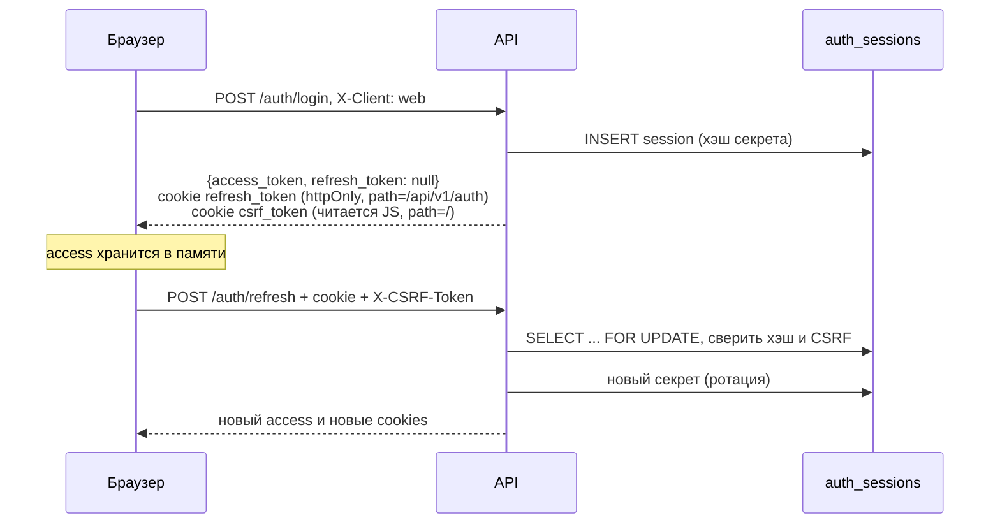

# Аутентификация и права

Код: `core/security/tokens.py`, `core/security/passwords.py`, `service/auth/`,
`api/v1/auth/`, `api/deps.py` (`current_user`, `require`). Общая схема слоёв: [architecture.md](architecture.md).

## Токены

| | Access | Refresh |
| --- | --- | --- |
| Формат | JWT RS256 | непрозрачная строка `<session_id>.<secret>` |
| Срок | 15 минут (`ACCESS_TTL`) | 30 дней, продлевается при ротации (`REFRESH_TTL`) |
| На сервере | нигде | таблица `auth_sessions`, только SHA-256 от `secret` |
| Содержимое | `sub`, `sid`, `av` (auth_version), `typ`, `iat`, `exp` | ничего, это ключ в БД |

## Web и mobile



Браузер (`X-Client: web`, по умолчанию) получает refresh-токен в httpOnly-cookie, которую JS не
видит, и cookie уходит только на `/api/v1/auth/*`. От CSRF защищает double-submit: SPA повторяет
значение cookie `csrf_token` в заголовке `X-CSRF-Token`, а сам CSRF-токен это HMAC от
refresh-токена. Мобильный клиент (`X-Client: mobile`) получает оба токена в теле и шлёт refresh как
`Authorization: Bearer`.

## Ротация и кража

На каждом refresh секрет меняется. Если пришёл старый секрет живой сессии, токен скопировали.
Кто из двоих вор, неизвестно, поэтому сессия умирает целиком (`REFRESH_TOKEN_REUSED`). Два
параллельных refresh одним токеном сериализуются блокировкой строки, и проходит только один
(`test_parallel_refreshes_with_one_token_cannot_both_win`).

## Мгновенный отзыв: `auth_version`

Access-токен нигде не хранится, поэтому отозвать один конкретный нельзя. В токене лежит `av`, в
строке пользователя `auth_version`, и `resolve_current_user` на каждом запросе сверяет их одним
запросом по первичному ключу. Бан и «выйти везде» (`POST /auth/logout-all`) увеличивают
`auth_version`, и все выданные access-токены умирают на следующем запросе. Обычный `logout`
отзывает только refresh-сессию, access доживает свои 15 минут.

## Пароли и лимиты

argon2id в отдельном потоке, чтобы не блокировать event loop. Для неизвестного email проверка всё
равно идёт против фиктивного хэша: время ответа не выдаёт, какие email зарегистрированы. При смене
параметров argon2 хэш обновляется при следующем входе (`needs_rehash`).

`/auth/register`, `/auth/login` и `/auth/refresh` ограничены по IP (`AUTH_RATE_LIMIT_PER_MINUTE`,
окно 60 с). Если Redis недоступен, лимитер пропускает запросы: падение Redis не должно запирать
пользователей снаружи.

## Роли и права

Роли описаны в коде, не в таблицах (`domain/users/models.py`):

```python
class Permission(StrEnum):
    USERS_READ = "users:read"
    USERS_BAN = "users:ban"
    USERS_MANAGE_ROLES = "users:manage_roles"
    STATS_READ = "stats:read"

ROLE_PERMISSIONS: Mapping[Role, frozenset[Permission]] = {
    Role.MEMBER: frozenset(),
    Role.ADMIN: frozenset(Permission),
}
```

Эндпоинт проверяет право, а не название роли:

```python
@router.post(path="/{user_id}/ban", dependencies=[Depends(require(Permission.USERS_BAN))])
async def ban_user(user_id: UUID, svc: ModerationServiceDep) -> UserOut: ...
```

У пользователя одна колонка `role` (Postgres enum), проверка прав не ходит ни в БД, ни в Redis.
Новая роль: значение в `Role`, строка в `ROLE_PERMISSIONS`, миграция enum'а. Роутеры не меняются.
Почему роль одна и как перейти на несколько: [D-005](../DECISIONS.md#d-005).

Правила, зависящие от данных («нельзя банить админа», «нельзя менять свою роль»), живут в
`domain/users/rules.py` и вызываются из сервиса. `require()` знает только, кто звонит.

Первый админ создаётся из CLI: `make admin email=you@example.com` (пароль спросит или возьмёт из
`ADMIN_PASSWORD`).
