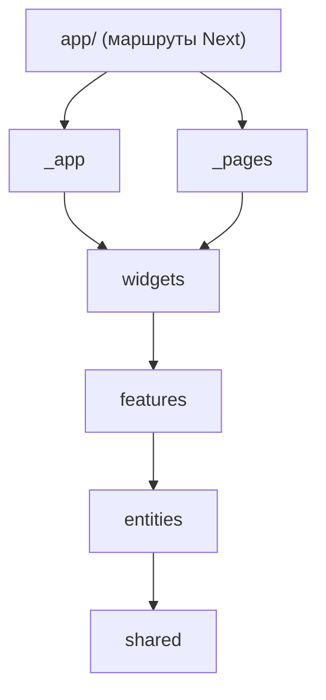

# Архитектура фронтенда

Next.js App Router и [Feature-Sliced Design](https://feature-sliced.design/). Маршруты Next лежат
в корневом `frontend/app/`, весь код в `frontend/src/` по слоям FSD. Слои `app` и `pages`
называются `_app` и `_pages`, как советует
[официальный гайд FSD для Next.js](https://feature-sliced.design/docs/guides/tech/with-nextjs):
иначе имена конфликтуют с роутером Next.

## Слои



| Слой | Что лежит | Пример |
| --- | --- | --- |
| `app/` (корень) | только маршруты: файл реэкспортирует страницу или layout из `src` | `app/(app)/profile/page.tsx` |
| `_app` | провайдеры (`entrypoint`), layout'ы и guard'ы, глобальные стили | `RequireSession`, `RequireAdmin` |
| `_pages` | экран целиком: собирает виджеты и фичи, своей логики нет | `profile`, `admin-users` |
| `widgets` | крупный самостоятельный блок экрана | `app-header`, `users-table`, `user-stats` |
| `features` | действие пользователя: форма, кнопка, мутация | `auth`, `edit-profile`, `moderate-user` |
| `entities` | данные предметной области: типы, маппер, API, запросы, маленький UI | `session`, `user`, `user-activity` |
| `shared` | без бизнес-смысла: HTTP-клиент, ошибки, типы OpenAPI, shadcn/ui, утилиты, маршруты | `shared/api`, `shared/ui/button` |

Правила проверяет steiger (`npm run check:architecture`):

- слой импортирует только слои ниже себя;
- слайсы одного слоя не импортируют друг друга;
- в слайс заходят только через его `index.ts`. Внутри слайса сегменты `ui`, `model`, `api`, `lib`.

## Данные

```text
openapi.json ──make openapi──▶ shared/api/schema.d.ts (типы DTO)
                                       │
entities/user/api/user-api.ts ──▶ mappers.ts (DTO → User) ──▶ queries.ts (useMe, useUsers)
                                                                     │
features/edit-profile (useMutation, invalidate userKeys) ◀──────────┘
```

- DTO не пишутся руками: `Schemas["UserOut"]` берётся из сгенерированной схемы. После изменения API
  `make openapi`, и TypeScript покажет все места, которые нужно поправить.
- Экран работает с UI-моделью (`User` в camelCase). Знает формат API только `entities/*/api/mappers.ts`.
- Серверное состояние живёт только в TanStack Query. Ключи задают фабрики (`userKeys.me()`,
  `userKeys.list(query)`), фичи инвалидируют ровно то, что изменили.
- Ошибки разбирает одна функция: `problemMessage(error, { EMAIL_TAKEN: "…" })`. Код ошибки это
  сгенерированный union `ErrorCode`, опечатку поймает TypeScript.

## Сессия

`shared/api/http.ts` хранит access-токен в памяти, подставляет `Authorization` и при 401 один раз
обновляет токен через `/auth/refresh` (общий промис на все параллельные запросы, заголовок
`X-CSRF-Token` из cookie). `entities/session` решает, вошёл ли пользователь: при загрузке пробует
refresh, `start(token)` после входа, `end()` при выходе или окончательном 401 (заодно чистит кэш
запросов). Guard'ы в `_app/layouts/guards.tsx` перенаправляют на `/auth?next=…` и обратно,
пропуская только локальные пути (`shared/lib/navigation.ts`).

## Новый экран

1. Данные: `entities/<имя>` (или расширить существующую), `make openapi` для типов.
2. Действия: `features/<глагол-объект>` с `model/use-*.ts` и `ui/*.tsx`.
3. Экран: `_pages/<имя>/ui/<Имя>Page.tsx` и `index.ts`.
4. Маршрут: `app/(app)/<путь>/page.tsx` с одной строкой
   `export { XPage as default } from "@/_pages/x";`. Публичные страницы кладутся вне группы `(app)`.
5. Ссылка в `widgets/app-header`, тест в `tests/app.spec.ts`.

## Проверки

```bash
npm run check        # ESLint, TypeScript, steiger, vitest, production build
npm run test:e2e     # Playwright на 1440, 1366 и 390 px с моком API
```

Unit-тесты (vitest) покрывают чистый код: мапперы, разбор ошибок, безопасный `next`. Экраны
проверяет Playwright со своим in-memory бэкендом в `tests/app.spec.ts`, который ведёт себя как
FastAPI (cookies, CSRF, коды ошибок). Перед тем как назвать UI готовым, экраны смотрят глазами на
десктопе и телефоне: [guides/design.md](../guides/design.md).
